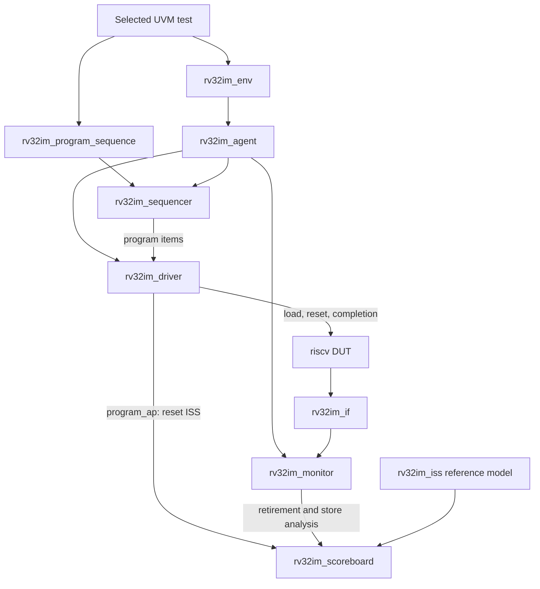

# RV32IM Behavioral Simulation Strategy

## 1. Purpose and Scope

This document describes the behavioral simulation strategy for the RV32IM pipelined processor. It inventories the program memory images, identifies the most important functional and corner-case scenarios, explains the UVM testbench structure, and defines regression pass criteria.

The strategy targets RTL functional behavior: instruction execution, pipeline data/control hazards, register and memory effects, divider/multiplier behavior, and top-level MMIO interaction. It is not a gate-level timing or physical implementation plan.

## 2. Simulation Layers

Use complementary levels of simulation so a failure can be localized efficiently:

| Level | Existing testbench | Primary purpose |
|---|---|---|
| Arithmetic unit | `tb/tb_cla.sv`, `tb/tb_alu.sv` | Check CLA arithmetic, ALU operations, flags, and multiply-high signedness. |
| Divider unit | `tb/tb_div_unit.sv` | Check divider arithmetic, latency, transaction tags, PC/instruction tracking, reset, and throughput. |
| Program-level | `tb/tb_riscv_programs.sv` | Run memory images against the processor and check signatures and selected RAM locations. |
| UVM system-level | `tb/rv32im_uvm_tb.sv` | Compare retirements and stores against an instruction-set reference model; run directed, memory-image, and constrained-random programs. |

Unit-level benches provide fast diagnosis. Program-level and UVM runs validate interactions across the complete pipeline and memory system.

## 3. Memory Image Inventory

The five `*_test.mem` files are executable programs. Their adjacent `.dump` files document instruction purpose and expected behavior; the simulation loads the `.mem` images, not the `.dump` files.

| Image | Main scenarios | Expected evidence |
|---|---|---|
| `tb/mem/basic_instructions_test.mem` | RV32I register and immediate arithmetic/logical operations, register and immediate shifts, signed/unsigned comparisons, LUI, AUIPC, conditional checks. | PASS signature `0x55` at byte address `0x100` (`dmem[64]`); FAIL signature `0xEE` if an instruction check branches to the failure handler. |
| `tb/mem/pipeline_harzard_test.mem` | ALU forwarding, dependent arithmetic, SW/LW, immediate load-use dependency, branch using a recent result, wrong-path store suppression. The filename retains the repository spelling `harzard`. | `dmem[64]=30`, `[65]=50`, `[66]=7`, `[67]=20`; wrong-path location `[68]=0`; four stores are expected. |
| `tb/mem/load_store_subsystem_test.mem` | LB/LBU on all byte lanes, LH/LHU on both halfword lanes, SB on all byte lanes, SH on low/high halfwords, SW/LW, and immediate load consumers. | Seed `[64]=0x80FF8001`; byte-store word `[65]=0x44332211`; halfword-store word `[66]=0x04560123`; word test `[68]=0x89ABC123`; PASS signature at `[128]`. |
| `tb/mem/control_flow_corner_cases_test.mem` | Taken and not-taken branches, branch dependency, JAL/JALR redirect and link values, wrong-path flushes, x0 protection, JALR bit-zero clearing. | PASS signature at `[64]`. JALR starts from odd address `0x59` and must target `0x58`. Reset entry is assumed by the image and must be provided by the testbench. |
| `tb/mem/test_soc_all.mem` | SoC-level ALU, forwarding, load-use, branches, JAL/JALR links, RAM access, MUL/DIV/REM, and MMIO signature. | PASS is written to MMIO address `0x80000000`, which aliases to `dmem[0]`; RAM check expects `dmem[64]=10`. |

### Initialization Files

| File | Role |
|---|---|
| `tb/mem/imem.mem` | Default instruction-memory image (currently a NOP word); not a program scenario. |
| `tb/mem/dmem.mem` | Default data-memory initialization (zero); not a program scenario. |
| `tb/mem/dmem_zero.mem` | Zero image used by the non-UVM program runner to clear data memory between programs. |

The UVM driver loads its selected image into instruction memory through the testbench backdoor and clears data memory using a generated `uvm_dmem_zero.mem`. The RTL may still attempt to read `imem.mem` and `dmem.mem` at time zero; missing-file warnings are initialization warnings, not a UVM test result. Keep initialization warnings separate from scoreboard failures in reports.

## 4. Important Functional and Corner-Case Scenarios

Prioritize these scenarios because failures can silently corrupt later results or affect many instruction classes:

| Priority | Scenario | Why it matters | Existing evidence / recommended check |
|---|---|---|---|
| Critical | Register forwarding and RAW dependencies | A consumer may need an operand before it is written to the register file. | Pipeline image uses dependent ADD/SUB and SoC tests include a forwarding chain. Add operand dependencies at adjacent instructions and with one intervening instruction. |
| Critical | Load-use stall and forwarding | A load result arrives later than a normal ALU result. | Pipeline and load/store images consume loads immediately; verify result, PC order, and that no instruction is lost or duplicated. |
| Critical | Divider/writeback collision | A delayed DIV/REM writeback can coincide with an ordinary instruction reaching writeback. | UVM scoreboard and random programs expose result mismatches. Add directed DIV followed by independent ALU writes and stores at offsets spanning divider latency. |
| Critical | Control redirect and flush | Wrong-path instructions must not modify registers or memory. | Pipeline and control-flow images check a wrong-path store and wrong-path register writes. Verify PC, link value, and side effects. |
| Critical | JALR bit-zero clearing | The target address must have bit 0 cleared. | Control-flow image loads `0x59` and expects execution at `0x58`; this catches a PC-update defect. |
| High | Signed/unsigned load extension and lane selection | A lane or extension error can affect adjacent bytes and signed values. | Load/store image uses `0x80FF8001` to exercise sign and zero extension across lanes. Retain all expected word checks. |
| High | Store byte enables and preservation | SB/SH must update only selected byte lanes. | Load/store image assembles `0x44332211` and `0x04560123` from byte/halfword stores and checks surrounding memory. |
| High | Signed versus unsigned comparisons | Values with bit 31 set compare differently as signed and unsigned integers. | Basic image checks SLT/SLTU and SLTI/SLTIU. Add boundary pairs `0x80000000`, `0x7fffffff`, `0xffffffff`, zero, and equality. |
| High | M-extension high-product signedness | MULH, MULHSU, and MULHU share datapath resources but require different extension rules. | UVM arithmetic program checks all multiply variants and includes the regression vector `0xfffffffa * 0xfffffffa`, whose MULHU high word is `0xfffffff4`. |
| High | Divider corner semantics | Divide by zero and signed overflow have specified results; signed REM follows dividend sign. | UVM arithmetic and `tb/tb_div_unit.sv` cover these cases. Keep quotient, remainder, and destination/PC/instruction tags checked. |
| High | x0 and reset state | Writes to x0 must be discarded; reset establishes a known starting state. | Control-flow image attempts to write x0. Assert reset before every program and check reset behavior at the unit level. |
| Medium | MMIO alias and completion signature | A test can report a PASS signature while unrelated architectural checks still fail. | SoC image uses `0x80000000`; require both signature and scoreboard/final-state success. |

The core does not currently implement an instruction-address misalignment trap path. The control-flow image tests JALR bit-0 clearing, not general misaligned-instruction exception handling. Define the supported behavior before adding tests that expect traps.

## 5. UVM Testbench Contents

The UVM package, interface, components, tests, and HDL top are all in `tb/rv32im_uvm_tb.sv`. A selected test submits complete program images to the driver. The driver does not send one UVM sequence item per instruction; instruction activity is observed from the DUT's retirement trace and memory write ports.

### Component Hierarchy



### What Each Part Does

| Element | Responsibility and interaction |
|---|---|
| `rv32im_uvm_tb` top module | Creates the clock and `riscv` DUT, wires the virtual interface to the DUT's retirement/writeback, store, and EX diagnostic signals, configures the backdoor and interface with `uvm_config_db`, and calls `run_test()`. `+UVM_TESTNAME=<class>` selects the registered test. |
| `rv32im_if` | Carries sampled DUT signals between the HDL top and UVM classes. Its `monitor_cb` clocking block samples on the rising edge with `#1step`, avoiding races with sequential updates. It includes architectural retirement/store signals and EX operand/forwarding diagnostics. |
| `rv32im_program_item` | The transaction for one whole program run: instruction image, cycle limit, optional signature word and PASS/FAIL markers, run status, and elapsed cycles. |
| `rv32im_program_sequence` | Sends its assigned program item to the sequencer. It does not encode individual RISC-V instructions into separate UVM transactions. |
| `rv32im_sequencer` | Standard UVM sequencer that arbitrates program items between the sequence and driver. |
| `rv32im_driver` | Receives one program item, asserts reset, loads the image into IMEM through the backdoor, clears DMEM, informs the scoreboard to reset its ISS, releases reset, and waits for the configured store signature or cycle timeout. It then drains the pipeline before completing the item. |
| `rv32im_monitor` | Observes the DUT independently of the driver. For each non-bubble retirement it publishes PC, instruction, write enable, destination, and writeback data. It separately publishes each observed store's address, byte enables, and data, and checks key signals for unknown values. `EX_OPERAND`, `EX_X1`, and `WB_X1` logs are targeted diagnostics for investigating datapath/forwarding failures. |
| `rv32im_iss` | The software reference model. It decodes and executes the modeled RV32I/RV32M instructions, advances architectural PC/register state, calculates loads/stores and branch outcomes, and supplies expected effects to the scoreboard. |
| `rv32im_scoreboard` | On program start, resets the ISS from the same image. It checks retirement PC/instruction/register writes, queues DIV/REM shells until their delayed writebacks arrive, matches expected and observed stores including lane masks, checks the final register file and full DMEM, and samples functional coverage. |
| `rv32im_agent` | Groups sequencer, driver, and monitor into one reusable UVM agent. Its connect phase connects the driver's sequence port to the sequencer. |
| `rv32im_env` | Builds the agent and scoreboard, then connects the driver's program analysis port and the monitor's retirement/store analysis ports to the scoreboard. |
| `rv32im_backdoor` / `tb_backdoor` | Abstracts hierarchical access used to load IMEM, clear DMEM, and read architectural state. The concrete implementation references the DUT's IMEM, DMEM, and register-file arrays. This is simulator-independent at the UVM API boundary but depends on the RTL hierarchy. |
| `rv32im_base_test` | Common setup and helpers: create the environment, load `.mem` files, create program items, run them, check expected register/memory values, and print the summary. Concrete tests extend it and implement `run_phase`. |

### Program Flow

1. The selected test creates a program image and wraps it in an `rv32im_program_item`.
2. Its sequence submits the item through the sequencer; the driver resets and loads the DUT and publishes the program to the scoreboard.
3. The scoreboard resets its ISS to the same image. The driver releases reset and starts the program.
4. The monitor samples retirements and stores. The scoreboard compares those events with the ISS and tracks delayed divider results.
5. The driver stops waiting when it sees the configured PASS/FAIL signature or reaches the timeout, then drains the pipeline.
6. The test calls `finish_program()`, which checks pending divider/stores and compares the full register file and DMEM. Program-level pass/fail counters are updated from status and errors.

The report's `Total Tests` is the number of program items passed to `run_item`, not the number of retired instructions. Instruction retirements, stores, divider writebacks, and explicit register/memory checks are reported or checked separately.

### Available UVM Tests

- `rv32im_directed_test`: forwarding, load-use, branch/JAL flush, MUL/DIV, and register checks.
- `rv32im_arithmetic_test`: RV32I ALU operations, branch/flush, memory access, all eight RV32M operations, divide corner cases, and the MULHU regression vector.
- `rv32im_mem_regression_test`: all five program images in `tb/mem` with signatures and selected expected memory checks.
- `rv32im_mem_file_test`: one user-selected image via `+MEM_FILE`, with optional signature and timeout plusargs.
- `rv32im_random_test`: constrained-random programs; defaults to 10 programs with body length 200.
- `rv32im_full_regression_test`: directed + arithmetic + five memory images + 10 random programs by default.

The current full-regression default is **17 program-level tests**: 1 directed + 1 arithmetic + 5 memory-image + 10 random. The summary's `Total Tests` counts program items submitted to `run_item`; it does not count retired instructions or individual assertions. The scoreboard checks those separately.

The constrained-random generator uses a small register pool, a fixed memory base, and forward-only control flow intended to terminate. Each generated image appends a PASS store to reserved `dmem[200]` (byte address `0x320`) followed by a park instruction; this address is outside the generator's random data-access range. The driver stops on this signature and then drains the pipeline, so divider work issued near an arbitrary cycle limit is not confused with a lost result. Reproduce random failures by recording the simulator seed and plusargs (`NUM_PROGRAMS`, `PROG_LEN`, `MEM_DIR`, and `UVM_TESTNAME`).

## 6. Unit-Level Coverage

- `tb/tb_cla.sv` checks directed carry/overflow cases, group-boundary and walking-bit patterns, 4,096 low-byte combinations, and 5,000 random additions.
- `tb/tb_alu.sv` checks RV32I ALU operations, multiply variants, comparison flags, control defaults, and random operands. Divider operations are not ALU results and are checked in the divider bench.
- `tb/tb_div_unit.sv` checks reset, signed/unsigned DIV/DIVU/REM/REMU, divide-by-zero, signed overflow, boundary operands, pipeline tags/latency, interleaved operations, and back-to-back random divider transactions.

These unit benches are valuable early gates, but passing them does not replace pipeline-level tests for forwarding, divider hazards, writeback arbitration, or memory effects.

## 7. Recommended Regression Procedure

1. Run the CLA, ALU, and divider unit benches after changes to their respective RTL.
2. Run `rv32im_arithmetic_test` to isolate architectural ALU/M behavior and its memory result checks.
3. Run `rv32im_mem_regression_test` to verify every checked-in program image and expected signature.
4. Run `rv32im_directed_test` for pipeline interactions, then run `rv32im_full_regression_test` for the integrated suite.
5. Run multiple recorded random seeds and vary `NUM_PROGRAMS`/`PROG_LEN`; preserve the failing seed and generated image when a random run fails.
6. For every run, check PC/instruction ordering, register-write comparisons, store address/data/strobes, divider completion, final register/memory state, timeout status, and UVM severity counts.

Example full regression command in the Xcelium environment:

```sh
./run_xcelium_sim.sh --top tb/rv32im_uvm_tb.sv --uvm \
  --test-name rv32im_full_regression_test --mem-dir tb/mem
```

Use `--test-name rv32im_arithmetic_test` or another registered class to run a focused UVM test. Non-UVM unit benches use their own top modules and do not require `--uvm`.

## 8. Pass Criteria and Reporting

A program is considered passed only when all of the following hold:

- The program does not time out or write its configured FAIL signature.
- The scoreboard reports zero PC, instruction, register, store, divider, and final-state mismatches.
- Explicit expected-register, expected-memory, and store-count checks pass.
- UVM `ERROR` and `FATAL` counts are zero for a clean regression; report simulator initialization warnings separately.
- The report records test class, seed, program count, program length, simulator version, and any plusargs needed to reproduce the run.

A PASS signature alone is not sufficient. For example, a control-flow image can reach its success store even if the scoreboard has already detected an architectural mismatch.

The scoreboard defines functional coverage for instruction, branch outcome, and recent RAW producer/distance. A previously captured console log reported `functional_coverage=0.00%`; do not present that as meaningful achieved coverage until sampling and simulator coverage settings have been verified. Report coverage by instruction/branch/hazard category, not only one aggregate number.

The UVM scoreboard now also has separate memory and divider coverage groups. Memory coverage samples access class, byte offset, and store strobe; divider coverage samples DIV/DIVU/REM/REMU, zero/nonzero divisor, operand signs, and signed overflow. The report prints commit, memory, and divider coverage percentages separately. The runner adds Xcelium `-coverage all` for UVM compile-and-run invocations. Coverage instrumentation is compiled into the simulation, so use a fresh compile-and-run after enabling it; a run-only invocation cannot add instrumentation to an older compiled snapshot.

## 9. Historical Console Snapshot

A previously attached full-regression log showed 17 program items, 7 passed, 10 failed, and 103 UVM errors. The control-flow failure identified a JALR target-bit-0 masking defect; random-program errors included a MULHU result mismatch and later PC/register/store mismatches. A subsequent run passed the directed and memory-image programs and reduced the total to 69 UVM errors, but still failed in random programs. RTL changes since that run correct JALR, give EX redirects priority over younger stalls, and extend the divider/writeback collision stall window; the arithmetic test includes the failing MULHU operand pair. These latest RTL changes have **not** been verified by a new simulation run. Report historical counts separately and rerun the full regression before claiming a clean result.
